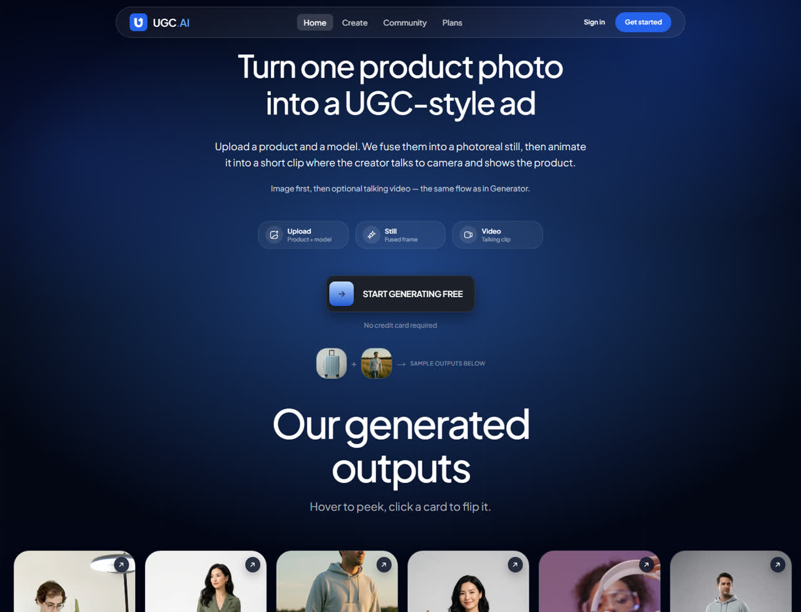
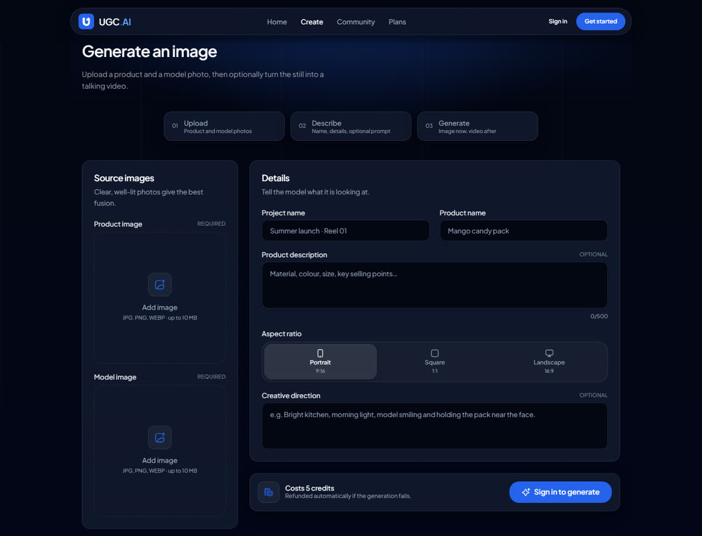
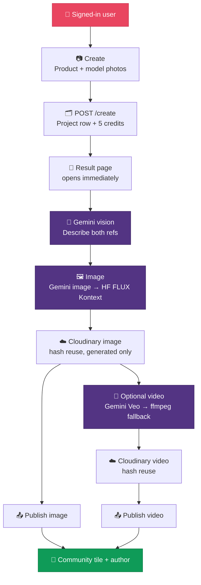

```
██╗   ██╗ ██████╗  ██████╗     █████╗ ██╗
██║   ██║██╔════╝ ██╔════╝    ██╔══██╗██║
██║   ██║██║  ███╗██║         ███████║██║
██║   ██║██║   ██║██║         ██╔══██╗██║
╚██████╔╝╚██████╔╝╚██████╗    ██║  ██║██║
 ╚═════╝  ╚═════╝  ╚═════╝    ╚═╝  ╚═╝╚═╝
```

<div align="center">

### 🎬 AI-Powered Advertisement Video Generator

> *UGC.AI turns a product photo and a model photo into a photoreal image, then an optional talking video — the same Create → Result flow you use after sign-in.*

**Upload a product and a model. Get a UGC-style ad image, then a short clip where the creator talks to camera and shows the product.**

[](https://reactjs.org/)
[](https://nodejs.org/)
[](https://tailwindcss.com/)
[](https://expressjs.com/)
[](https://neon.tech/)
[](https://cloudinary.com/)
[](https://ai.google.dev/)
[](https://huggingface.co/)


[](https://github.com/ShubhamNegi-07/UGC-Ad-Fusion-AI-powered-Advertisement-Video-Generator)
[](https://github.com/ShubhamNegi-07/UGC-Ad-Fusion-AI-powered-Advertisement-Video-Generator)





</div>

---

## 📌 Table of Contents

- [What is UGC.AI?](#-what-is-ugcai)
- [Why This Exists](#-why-this-exists)
- [How It Works](#-how-it-works)
- [Key Features](#-key-features)
- [Tech Stack](#-tech-stack)
- [System Architecture](#-system-architecture)
- [Getting Started](#-getting-started)
- [Use Cases](#-use-cases)
- [Roadmap](#-roadmap)
- [Author](#-author)
- [Contributing](#-contributing)

---

## 🚀 What is UGC.AI?

**UGC.AI** is a full-stack studio that fuses **your product photo** and **your model photo** into a photoreal advertisement image, then can animate that frame into a short talking video.

No script writer. No stock avatar. No separate ad editor.

| Step | Screen | Credits |
|------|--------|---------|
| Product + model photos | Create | — |
| Photoreal fused image | Result | 5 |
| Optional talking video | Result | 10 |
| Publish image and/or video | Community | — |

The live site has six user-facing pages:

| Page | Route | What it is |
|------|-------|------------|
| **Home** | `/` | Marketing hero, sample outputs (Talking, Fusion, Sneakers, Studio, Headphones, Creator), FAQ |
| **Create** | `/generate` | Product + model uploads, name/description, 9:16 · 1:1 · 16:9, optional prompt |
| **Result** | `/result/:projectId` | Polls the image, then optional video; publish / remove per media |
| **My generations** | `/my-generations` | Signed-in library of your projects |
| **Community** | `/community` | Public image and video tiles with the author's name and avatar |
| **Plans** | `/plans` | Free tier only — 20 starting credits; paid checkout is not live |

---

## 💡 Why This Exists

| Traditional Ad Creation | ⚡ UGC.AI |
|---|---|
| 🕐 Days to weeks of production time | ✅ Minutes from two photos to an image, then a clip |
| 💸 Studio shoot + editor per variation | ✅ One signed-in account, 20 credits to start |
| 🧍 Hire a creator who matches the brand | ✅ You upload the model you want in the frame |
| 🔁 Manual republish of image vs video | ✅ Publish image and video independently |
| 📉 Hard to show work publicly | ✅ Community feed with who posted each tile |

---

## 🧠 How It Works

Image first, then optional talking video — the same flow as Home and Create.

| | Create | Result | Result |
|---|---|---|---|
| **Output** | Product + model photos | Fused image | Talking clip |
| **Where** | `/generate` | `/result/:id` | `/result/:id` |
| **Credits** | — | 5 | 10 |

### Step-by-Step Breakdown

| Step | Module | What Happens |
|------|--------|--------------|
| 1️⃣ | **Create** | Sign in with Clerk. Upload JPG / PNG / WEBP (up to 10 MB each). Name the product, pick 9:16, 1:1, or 16:9, optional prompt. |
| 2️⃣ | **Result (immediate)** | Create saves the project as JSON, then the app opens `/result/:id` while generation starts in the background. |
| 3️⃣ | **Image** | Gemini vision describes the two references. Image generation tries Gemini first, then Hugging Face **FLUX Kontext**. Cost: **5 credits** (refunded if the image fails). |
| 4️⃣ | **Video** | Optional. Gemini Veo image-to-video, or a local ffmpeg motion pass if Veo is unavailable. Cost: **10 credits**. |
| 5️⃣ | **Storage** | Cloudinary keeps **generated images and videos only** (`ugc-ad-fusion/out-…` / `vid-…`, reused by content hash). Source photos stay on the request, not as extra Cloudinary originals. |
| 6️⃣ | **Publish** | On Result, **Publish image** and **Publish video** are separate. Community shows the author on each tile. Downloads stay in-page (blob + allowlisted proxy). |

Credits are hard-capped at **20**. New users start at 20. Refunds and webhooks cannot push a balance above 20. Paid packs are **not** enabled on Plans.

---

## ✨ Key Features

| Feature | Description |
|---------|-------------|
| 🖼️ **Dual-photo images** | Product + model stay in the same frame — face, outfit, and product branding are the generation target |
| 🎥 **Talking video** | Optional clip from the finished image (Veo, with ffmpeg fallback) |
| 📤 **Independent publish** | Image and video can each be public or removed without hiding the other |
| 👥 **Community authors** | Feed tiles show who posted; sample UGC.AI outputs sit at the top |
| 💳 **20-credit cap** | 5 per image, 10 per video; balance cannot climb past 20 |
| 📱 **Responsive studio** | Two-column uploads on phones, three-step header, generate action in the form (not a stuck sticky bar) |
| 🦴 **Page-matched skeletons** | Home, Create, Result, Community, My generations, and Plans each show a layout that matches that page |
| ⬇️ **In-app download** | Share and download on Community tiles stay on the site — no extra browser tab |
| 🔐 **Clerk auth** | Sign in / Get started on the marketing nav; credits in the navbar when signed in |

---

## 🏗️ Tech Stack

<div align="left">

**🖥️ FRONTEND**

[](https://reactjs.org/)
[](https://tailwindcss.com/)
[](https://www.typescriptlang.org/)

**⚙️ BACKEND**

[](https://nodejs.org/)
[](https://expressjs.com/)
[](https://www.prisma.io/)

**🤖 AI & MEDIA**

[](https://ai.google.dev/)
[](https://huggingface.co/)

**🗄️ DATABASE & STORAGE**

[](https://neon.tech/)
[](https://cloudinary.com/)

**🔐 AUTH & MONITORING**

[](https://clerk.com/)
[](https://sentry.io/)

</div>

---

## ⚙️ System Architecture



---

## 📦 Getting Started

There is **no root `npm install`**. The app is two packages: `client` (Vite on port `5173`) and `server` (Express on port `5000`).

### Prerequisites

- **Node.js** v18+
- **npm**
- Keys for **Clerk**, **Cloudinary**, a **Neon / Postgres** `DATABASE_URL`, and at least one of **`GEMINI_API_KEY`** or **`HF_TOKEN`**

### Installation

```bash
# 1. Clone the repository
git clone https://github.com/ShubhamNegi-07/UGC-Ad-Fusion-AI-powered-Advertisement-Video-Generator.git

# 2. Navigate into the project
cd UGC-Ad-Fusion-AI-powered-Advertisement-Video-Generator
```

### Configuration

```bash
cp server/.env.example server/.env
cp client/.env.example client/.env
```

`server/.env` needs:

- `DATABASE_URL`
- `CLERK_PUBLISHABLE_KEY`, `CLERK_SECRET_KEY`
- `CLOUDINARY_CLOUD_NAME`, `CLOUDINARY_API_KEY`, `CLOUDINARY_API_SECRET`
- `GEMINI_API_KEY` and/or `HF_TOKEN` (images use Gemini first, then FLUX Kontext)

`client/.env` needs `VITE_CLERK_PUBLISHABLE_KEY`. `VITE_BASEURL` defaults to `http://localhost:5000`.

Gemini native image models need AI Studio billing, so they stay off unless you set `GEMINI_TRY_IMAGE=1`. Hugging Face images need a token plus FLUX Kontext access/credits.

### Run

```bash
# API — http://localhost:5000
cd server
npm install
npx prisma migrate deploy
npm run dev

# Web app — http://localhost:5173
cd client
npm install
npm run dev
```

> The API runs at `http://localhost:5000`. The web app runs at `http://localhost:5173`.

---

## 📌 Use Cases

| Industry | Use Case |
|----------|----------|
| 🛍️ **E-commerce** | Product-in-hand images and talking clips from catalog + model photos |
| 🚀 **Startups** | Launch creatives without a production team |
| 📱 **Social Media Agencies** | 9:16 / 1:1 / 16:9 outputs for Reels, Shorts, and feed |
| 🎯 **Performance Marketers** | Fast image + video variants from the same two uploads |
| 🎥 **Content Creators** | Keep your own face and product in the generated frame |

---

## 🔮 Roadmap

- [x] Dual-photo image generation (Gemini → Hugging Face FLUX Kontext)
- [x] Talking video from the finished image (Veo, ffmpeg fallback)
- [x] Immediate Create → Result navigation
- [x] Cloudinary stores generated image + video only
- [x] Independent Community publish for image and video, with author
- [x] Credits start at 20 and cannot exceed 20
- [x] Page-matched skeletons and responsive Create / Community
- [x] In-app Community download (no extra tab)
- [ ] Paid credit packs and checkout (Plans already shows **Coming soon**)

---

## 👨‍💻 Author

<div align="center">

**SHUBHAM NEGI**

[](https://github.com/ShubhamNegi-07)
[](https://www.linkedin.com/in/shubham-singh11/)

</div>

---

## 🤝 Contributing

Contributions are welcome and appreciated!

```bash
# 1. Fork the repository
# 2. Create your feature branch
git checkout -b feature/AmazingFeature

# 3. Commit your changes
git commit -m 'Add AmazingFeature'

# 4. Push to your branch
git push origin feature/AmazingFeature

# 5. Open a Pull Request
```

Please open an [Issue](https://github.com/ShubhamNegi-07/UGC-Ad-Fusion-AI-powered-Advertisement-Video-Generator/issues) to discuss any major changes first.

---

## ⭐ Support the Project

If UGC.AI helped or inspired you:

- ⭐ **Star** this repository
- 🍴 **Fork** and build on top of it
- 📣 **Share** it with someone who needs it
- 🐛 **Report bugs** or suggest features via [Issues](https://github.com/ShubhamNegi-07/UGC-Ad-Fusion-AI-powered-Advertisement-Video-Generator/issues)

---

<div align="center">

**UGC.AI** — product + model in, photoreal image and talking clip out.

*Built with ❤️ by [Shubham Negi](https://github.com/ShubhamNegi-07)*

</div>
